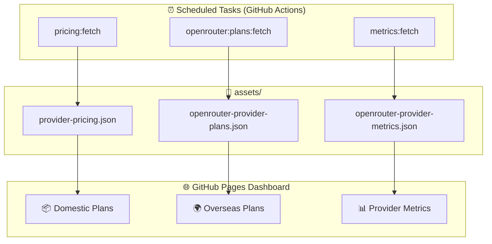

<div align="center">

[**English**](README.md) · [**简体中文**](README.zh-CN.md)

</div>

# Coding Plans for Copilot


**Switch between multiple AI model vendors with one click, breaking Copilot plan limitations.**

Supports domestic major vendors like Zhipu, Kimi, iFlytek, Volcengine, MiniMax, Baidu Qianfan, Tencent Cloud, JD Cloud, Kuaishou KAT, X-AIO, Compshare, Alibaba Cloud, Xiaomi MiMo, DeepSeek, as well as **any** vendor that follows OpenAI Chat, OpenAI Responses, or Anthropic protocol styles. No need to change usage habits; call them directly in VS Code Copilot Chat.

This extension is a general protocol adapter, not a clone of Copilot's private endpoint protocol. It sends public OpenAI/Anthropic-compatible fields and avoids Copilot-private request fields; as a result, it can work with Codex, Claude Code, and similar reverse-proxied APIs that native VS Code/Copilot Chat endpoint requests usually cannot call directly.

---

## VS Code for the Web

Coding Plans runs in VS Code for the Web, including `vscode.dev` and `github.dev`. The language model provider, vendor configuration and Secret Storage API keys, model refresh, model-configuration copy, usage status, and commit-message commands remain available when the host provides Copilot Chat and an SCM/Git provider.

- Browser extension hosts cannot run a local Git executable. When `coding-plans.commitMessage.useRecentCommitStyle` is enabled, the web host skips only the optional recent-commit style samples; commit generation still uses the current SCM diff.
- Requests originate in the browser extension host. Each configured API endpoint, including `/models` and optional usage endpoints, must allow the required cross-origin requests (CORS). Use a CORS-enabled vendor endpoint or proxy when the upstream API does not support browser requests.

## Core Features

- **Multi-Protocol Unified Access**: Supports OpenAI Chat (`/chat/completions`), OpenAI Responses (`/responses`), and Anthropic (`/messages`) three protocol styles, adapting to any compatible vendor.
- **General Request Format**: Avoids Copilot-private request fields and sends public compatible fields, enabling Codex, Claude Code, and similar reverse-proxied OpenAI/Anthropic-style APIs.
- **Anthropic Protocol First**: Built-in vendors default to Anthropic-style endpoints (`/messages`).
- **Zero Learning Curve**: Fully integrated into VS Code Copilot Chat without changing any operational habits.
- **Flexible Model Management**: Supports dynamic fetching from `/models` endpoint, or custom model lists.
- **Intelligent Commit Generation**: Automatically generates Conventional Commits-compliant commit messages based on Git changes.
- **Coding Plans Dashboard**: Visit [GitHub Pages Dashboard](https://jqknono.github.io/coding-plans-for-copilot/) to view monthly fees and benefits from multiple coding plans, as well as OpenRouter vendor performance metrics. The dashboard updates daily with automated scraping, multi-dimensional filtering, and URL state sync.
- **Key Security**: API Keys are stored locally using VS Code Secret Storage, not uploaded to the cloud or shared.

---

## Quick Start

### Installation

**Recommended Method**: Search "Coding Plans" or `Coding Plans for Copilot` directly in the VS Code Marketplace.

#### Method 1: Install within VS Code (Recommended)

1. Open VS Code
2. Press `Ctrl+Shift+X` to open the Extensions panel
3. Type `Coding Plans for Copilot` in the search box
4. Click **Install** to install
5. After installation, press `Ctrl+Shift+P` and type `Coding Plans` to see related commands

#### Method 2: Command Line Installation

```bash
code --install-extension techfetch-dev.coding-plans-for-copilot
```

#### Method 3: Install from Marketplace Page

👉 [VS Code Marketplace Direct Link](https://marketplace.visualstudio.com/items?itemName=techfetch-dev.coding-plans-for-copilot)

Click the **Install** button on the marketplace page, which will automatically open the extension in VS Code and install it.

> **Prerequisites**: Requires VS Code ≥ 1.142.0 and the [GitHub Copilot](https://marketplace.visualstudio.com/items?itemName=GitHub.copilot) extension installed.

### Configuration

To add a custom endpoint, open **Language Models → Add Models → Coding Plans**, then enter the vendor name, **Base URL**, and optional API Key. Vendor metadata is saved in user/global `coding-plans.vendors`; API keys are stored only in VS Code Secret Storage. New vendors default to `chat-completions` with `/models` discovery enabled. With a stored API key, Add Models automatically fetches that vendor's model list, saves it, and displays the models, even when `autoRefreshModels` is disabled. Each connection configuration is discovered once per extension session; repeated/concurrent picker queries do not repeat discovery. Use **Coding Plans: Update Coding Plans Models List** to retry a failed discovery or refresh later, or configure models/protocols manually. Existing vendor options and model overrides are preserved. Workspace-level `vendors` arrays still override user settings; remove that override to use the global list.

For a built-in or already configured vendor:

1. Press `Ctrl+Shift+P`, type `Coding Plans: Manage Vendor Configuration`
2. Pick the platform you've registered with from the vendor picker (e.g., Zhipu, Kimi, Volcengine, etc.)
3. Select "Set API Key" and paste your API Key; the extension stores it and refreshes models
4. Open Copilot Chat (`Ctrl+L`) and choose a model provided by `Coding Plans` in the model picker
5. Set `Thinking Effort` per request from the model row `More Actions` menu. OpenAI Chat-compatible models support `none` / `low` / `medium` / `high` / `xhigh` / `max`, and also show `Thinking Type` (`enabled` / `disabled` / `default`, default: `default`; `default` omits the `thinking` field and only sends `reasoning_effort`, matching native Custom Endpoint). Choose `enabled` to also send `thinking.enabled`. OpenAI Responses models support `low` / `medium` / `high` / `xhigh` / `max` (default: `max`). Anthropic models show `Effort` (`low` / `medium` / `high` / `xhigh` / `max`, default: `max`) and `Thinking Type` (`think` / `non-think`, default: `think`); `think` sends `thinking.enabled` with `budget_tokens` mapped from Effort, and `non-think` disables thinking. Copilot Chat may pass `reasoningEffort` instead of `thinkingEffort`; the adapter maps that alias. More Actions also exposes Context Size for the input budget.
6. With `useModelsEndpoint` enabled, run `Coding Plans: Update Coding Plans Models List` to request `/models`, write back the model list and refresh the picker. Settings/API-key changes always rebuild configured models locally, applying budgets immediately. `coding-plans.autoRefreshModels: false` disables automatic picker synchronization and empty-query refresh; remote discovery and model-list writeback remain manual except for the native Add Models connection setup described above.
   - Discovery prefers [models.dev](https://models.dev/) `catalog.json`, falling back to `api.json`, to enrich new model entries with capability, source and price metadata by model ID/name. New model `apiStyle` follows its source: OpenAI and Grok/xAI use `responses`, Anthropic uses `messages`, and other models use `chat-completions`. Existing manual attributes and budgets remain intact; automatically sourced capabilities can refresh.
You can also directly edit `settings.json`; the extension will open settings and navigate to `coding-plans.vendors`.

### Built-in Vendor Endpoints

The following vendors come with built-in default configurations and are ready to use after installation:

| Vendor | Default Built-in Endpoint | Other Endpoints |
| --- | --- | --- |
| Zhipu (zhipu) | `https://open.bigmodel.cn/api/coding/paas/v4` | `https://open.bigmodel.cn/api/anthropic` (Claude Code) / `https://open.bigmodel.cn/api/paas/v4` (general) |
| z.ai | `https://api.z.ai/api/anthropic` | `https://api.z.ai/api/coding/paas/v4` |
| Volcano Engine (火山引擎) | `https://ark.cn-beijing.volces.com/api/coding/v3` (Responses) | `https://ark.cn-beijing.volces.com/api/coding/v1` (Anthropic; `authType: "bearer"`) |
| Volcengine Overseas | `https://ark.ap-southeast.bytepluses.com/api/coding` | `https://ark.ap-southeast.bytepluses.com/api/coding/v3` |
| Kimi | `https://api.kimi.com/coding/v1` | `https://api.kimi.com/coding/v1` |
| Alibaba Cloud (Aliyun) | `https://token-plan.cn-beijing.maas.aliyuncs.com/apps/anthropic` | `https://token-plan.cn-beijing.maas.aliyuncs.com/compatible-mode/v1` |
| Tencent Cloud | `https://api.lkeap.cloud.tencent.com/plan/anthropic` | `https://api.lkeap.cloud.tencent.com/plan/v3` |
| Xiaomi MiMo | `https://token-plan-cn.xiaomimimo.com/anthropic` | `https://token-plan-cn.xiaomimimo.com/v1` |
| DeepSeek | `https://api.deepseek.com/anthropic` | `https://api.deepseek.com/v1` |
| OpenRouter | `https://openrouter.ai/api` | `https://openrouter.ai/api/v1` |

To switch to OpenAI-compatible endpoints, modify the vendor's `baseUrl` and `defaultApiStyle`.
The built-in Zhipu default uses the dedicated GLM Coding Plan endpoint `https://open.bigmodel.cn/api/coding/paas/v4`. If you want the Claude Code-compatible entrypoint instead, switch `baseUrl` to `https://open.bigmodel.cn/api/anthropic` and set `defaultApiStyle` to `messages`.
The built-in Xiaomi MiMo default uses the Token Plan endpoint. If you want pay-as-you-go API access instead, switch `baseUrl` to `https://api.xiaomimimo.com/anthropic` (`https://api.xiaomimimo.com/v1` for OpenAI compatibility) and use the matching API key.

#### Volcano Engine Coding Plan

The built-in vendor keeps the name `火山引擎` (including its Secret Storage key association). It uses `defaultApiStyle: "responses"`, `baseUrl: "https://ark.cn-beijing.volces.com/api/coding/v3"`, and `useModelsEndpoint: false`. The resulting request URL is `https://ark.cn-beijing.volces.com/api/coding/v3/responses`. Chat Completions is also supported at `/api/coding/v3/chat/completions`; Responses is the recommended default, not the only supported protocol.

The static model IDs are `doubao-seed-evolving`, `doubao-seed-2.1-turbo`, `doubao-seed-2.0-lite`, `minimax-m3`, `glm-5.3`, `glm-5.3-flash`, `deepseek-v4-flash`, `deepseek-v4-pro`, `kimi-k2.7-code`, and `kimi-k3`. No unverified per-model vision, context-window, or thinking settings are preset. Keep `models` populated and discovery disabled: even a forced refresh then uses the static list without requesting `/models`. Add the `火山引擎` provider group in Manage Language Models to see these models; the unscoped `Coding Plans` root remains hidden.

For the Anthropic-compatible alternative, set vendor `defaultApiStyle: "messages"`, `authType: "bearer"`, and `baseUrl: "https://ark.cn-beijing.volces.com/api/coding/v1"`, keeping `useModelsEndpoint: false` and the static models. This extension only appends `/messages`, producing `https://ark.cn-beijing.volces.com/api/coding/v1/messages`; do **not** copy Claude Code's `/api/coding` base URL directly. The official Claude Code setup uses `ANTHROPIC_AUTH_TOKEN`, hence Bearer authentication; this extension uses the key stored through Manage Vendor Configuration, not that environment variable. Anthropic Bearer requests still include `anthropic-version: 2023-06-01` and omit `x-api-key`.

**Existing explicit settings are not automatically replaced.** Manually update the existing `火山引擎` entry in `coding-plans.vendors` with the new endpoint, protocol, static models and `useModelsEndpoint: false`. An explicit `models[].apiStyle` takes precedence over `defaultApiStyle`; remove or update old model-level overrides too. Do not use the general `/api/v3` endpoint as a fallback: it is outside this Coding Plan route and may incur additional usage charges. A failed `/models` request falls back to configured/cached models; it does not necessarily clear the list.

References: [Claude Code authentication](https://docs.volcengine.com/docs/82379/1928262), [Codex Responses configuration](https://docs.volcengine.com/docs/82379/2556056), [Coding Plan API support](https://docs.volcengine.com/docs/82379/2188958). Upstream availability and account access still require verification with your own Coding Plan key.

### Configuration Examples

> Moonshot/Kimi note: some Anthropic-compatible entrypoints require a non-standard `reasoning_content` field on assistant tool-call history messages when thinking is enabled and a tool continuation occurs. They may return `thinking is enabled but reasoning_content is missing in assistant tool call message`. This project does not send that field by default on the Anthropic path. When using Moonshot/Kimi Anthropic entrypoints, disable thinking from the model row `More Actions`; if you need thinking, prefer the OpenAI Chat-compatible API and set `apiStyle` to `chat-completions`. See [Moonshot Anthropic Thinking Tool-Call Compatibility](docs/moonshot-anthropic-thinking-tool-call.md).

**Anthropic Style Example**

```json
{
  "coding-plans.vendors": [
    {
      "name": "my-anthropic-vendor",
      "baseUrl": "https://api.example.com/anthropic",
      "defaultApiStyle": "messages",
      "useModelsEndpoint": false,
      "models": [
        {
          "name": "my-model",
          "enabled": true,
          "capabilities": { "tools": true, "vision": false },
          "contextWindow": 160000,
          "maxInputTokens": 128000,
          "maxOutputTokens": 30000,
          "limitSource": "configured",
          "contextBudget": { "inputTokens": 64000, "outputTokens": 16000 }
        }
      ]
    }
  ]
}
```

**OpenAI Chat Style**

```json
{
  "coding-plans.vendors": [
    {
      "name": "my-openai-vendor",
      "baseUrl": "https://api.example.com/v1",
      "defaultApiStyle": "chat-completions",
      "useModelsEndpoint": true,
      "models": []
    }
  ]
}
```

**OpenAI Responses Style**

```json
{
  "coding-plans.vendors": [
    {
      "name": "openai-responses-demo",
      "baseUrl": "https://api.openai.com/v1",
      "defaultApiStyle": "responses",
      "useModelsEndpoint": false,
      "models": [
        {
          "name": "gpt-5",
          "apiStyle": "responses",
          "enabled": true,
          "editTools": ["apply-patch"],
          "price": {
            "inputCost": 4,
            "cacheCost": 1,
            "outputCost": 12
          },
          "maxInputTokens": 400000,
          "maxOutputTokens": 128000,
          "reasoningEffortFormat": "responses",
          "streaming": true,
          "supportsReasoningEffort": ["high", "xhigh", "max"],
          "capabilities": { "tools": true, "vision": false, "thinking": true },
          "zeroDataRetentionEnabled": false
        }
      ]
    }
  ]
}
```

### Configurable Items

Configuration accepts only current schema fields; vendor, model and `capabilities` objects have closed property sets. `apiStyle` / `defaultApiStyle` accept only `chat-completions`, `responses`, and `messages`. See the [one-time migration guide](docs/configuration-migration.md) for existing settings.

`Coding Plans` uses VS Code's native log channel. `coding-plans.logLevel` synchronizes the channel's native level, and Set Log Level in the Output panel can temporarily override it. At `Trace`, the first 1,000 characters of each system/user/assistant message are logged and may contain sensitive context; tool content and image data are excluded from this preview.

| Config Key | Type | Default Value | Description |
| --- | --- | --- | --- |
| `coding-plans.locale` | `string` | Empty | Accepts empty, `zh-CN`, or `en-US`. Adds a system instruction for natural-language responses and emitted reasoning/thinking; empty follows the request. |
| `coding-plans.logLevel` | `string` | `warn` | Sets the native channel level: `trace` / `debug` / `info` / `warn` / `error` / `off`; only `trace` logs request message content previews. |
| `coding-plans.autoRefreshModels` | `boolean` | `false` | Controls automatic picker synchronization and empty-query refresh. Local configuration still rebuilds immediately when disabled; remote discovery uses the manual update command. |
| `coding-plans.vendors` | `array` | Built-in vendor templates | Vendor configuration list. |
| `coding-plans.vendors[].name` | `string` | Required | Vendor unique name. |
| `coding-plans.vendors[].baseUrl` | `string` | Required | API base address. |
| `coding-plans.vendors[].authType` | `"bearer"` / `"x-api-key"` | Protocol-dependent | Optional override for chat and `/models`: omitted uses `x-api-key` for Anthropic and Bearer for OpenAI. Explicit values send only the selected auth header; Anthropic always keeps `anthropic-version`. Does not change `usageUrl` authentication. |
| `coding-plans.vendors[].usageUrl` | `string` | Empty | Plan usage API address; when configured, status bar displays quota percentage. |
| `coding-plans.vendors[].defaultApiStyle` | `string` | `chat-completions` | Protocol style: `chat-completions` / `responses` / `messages`. |
| `coding-plans.vendors[].useModelsEndpoint` | `boolean` | `true` (Volcano Engine template: `false`) | Whether to fetch model list from `/models`; running `Coding Plans: Update Coding Plans Models List` writes discovered models back to `models`. When false, even forced refresh uses only configured models. |
| `coding-plans.vendors[].models[].name` | `string` | Required | Model name. |
| `coding-plans.vendors[].models[].enabled` | `boolean` | `true` | Whether to show this model in Manage Language Models; set to `false` to keep it configured but hidden. |
| `coding-plans.vendors[].models[].description` | `string` | Empty | Model description. |
| `coding-plans.vendors[].models[].apiStyle` | `string` | Inherit from vendor | Model-level protocol style override. |
| `coding-plans.vendors[].models[].capabilities` | `object` | `{ tools: true, vision: false }` | Model capability declaration. `thinking` maps to models.dev `reasoning`. |
| `coding-plans.vendors[].models[].contextWindow` | `integer` | Known capacity | Total model context capability `C`, integer ≥ 2, separate from budgets. |
| `coding-plans.vendors[].models[].maxInputTokens` | `integer` | Known capacity | Integer ≥ 1; independent input capability `I`; selectable input ceiling is `min(I, C-R)`, using known constraints. |
| `coding-plans.vendors[].models[].maxOutputTokens` | `integer` | Known capacity | Integer ≥ 1; independent output capability `O`, constraining actual output budget `R`. |
| `coding-plans.vendors[].models[].contextBudget` | `object` | Input `400000` / output `50000` | `inputTokens` is the default input budget, `outputTokens` the actual output budget, and `presets` numeric input presets; model capabilities constrain the result. |
| `coding-plans.vendors[].models[].limitSource` | `string` | By source | `configured` preserves explicit limits; `endpoint` / `models.dev` permits capability refresh while keeping budgets separate. |
| `coding-plans.vendors[].models[].price.inputCost` | `number` | Empty | Input cost metadata in credits per 1M tokens, shown in the Manage Language Models Cost column. |
| `coding-plans.vendors[].models[].price.cacheCost` | `number` | Empty | Cached input cost metadata in credits per 1M tokens, shown in the Manage Language Models Cost column. |
| `coding-plans.vendors[].models[].price.outputCost` | `number` | Empty | Output cost metadata in credits per 1M tokens, shown in the Manage Language Models Cost column. |
| `coding-plans.vendors[].models[].price.longContextInputCost` / `longContextCacheCost` / `longContextOutputCost` | `number` | Empty | Long-context cost metadata in credits per 1M tokens. VS Code shows it in model hover details when supported. |
| `coding-plans.vendors[].models[].streaming` | `boolean` | `true` | Whether to prefer streaming requests; set to `false` to send non-streaming requests. |
| `coding-plans.vendors[].models[].capabilities.thinking` | `boolean` | `true` | Whether to expose and send reasoning/thinking parameters. |
| `coding-plans.vendors[].models[].supportsReasoningEffort` | `string[]` | Protocol defaults | Restricts model-row effort options and blocks unsupported effort values from request payloads. |
| `coding-plans.vendors[].models[].editTools` | `string[]` | `["apply-patch","multi-find-replace","find-replace","code-rewrite"]` | Copilot-style edit tool declaration passed through to VS Code/Copilot as `capabilities.editToolsHint` for edit-tool preference selection. |
| `coding-plans.vendors[].models[].reasoningEffortFormat` | `string` | Derived from protocol | Copilot-style reasoning effort wire-format metadata: `chat-completions` / `responses`. Not applicable for anthropic protocol. |
| `coding-plans.vendors[].models[].zeroDataRetentionEnabled` | `boolean` | Empty | Declarative metadata only; it does not change upstream provider retention behavior. |
| `coding-plans.commitMessage.showGenerateCommand` | `boolean` | `true` | Whether to show "Generate Commit Message" command. |
| `coding-plans.commitMessage.language` | `string` | `en` | Commit message language: `en` / `zh-cn`. |
| `coding-plans.commitMessage.useRecentCommitStyle` | `boolean` | `false` | Whether to reference the style of the latest 7 local commits. |
| `coding-plans.commitMessage.modelVendor` | `string` | Empty | Preferred vendor name when generating commit messages. |
| `coding-plans.commitMessage.modelId` | `string` | Empty | Preferred model name when generating commit messages. |
| `coding-plans.commitMessage.options.prompt` | `string` | Built-in prompt | Override generation prompt. |
| `coding-plans.commitMessage.options.maxDiffLines` | `number` | `10000` | Maximum number of lines to read from diff. |
| `coding-plans.commitMessage.options.pipelineMode` | `string` | `single` | Generation pipeline: `single` / `two-stage` / `auto`. |
| `coding-plans.commitMessage.options.maxBodyBulletCount` | `number` | `5` | Maximum number of body bullets. |
| `coding-plans.commitMessage.options.subjectMaxLength` | `number` | `72` | Maximum subject length. |
| `coding-plans.commitMessage.options.requireConventionalType` | `boolean` | `true` | Whether to enforce Conventional Commits type. |
| `coding-plans.commitMessage.options.warnOnValidationFailure` | `boolean` | `true` | Whether to show warning on validation failure. |

Store API keys through Set API Key in VS Code Secret Storage, associated with the vendor name. Native provider `configuration.apiKey` also writes to Secret Storage.

### Context Window Display

Configuration is organized by responsibility while retaining existing field paths:

| Group | Fields | Recommended use |
| --- | --- | --- |
| Model capability | `contextWindow`, optional `maxInputTokens`, `maxOutputTokens` | Usually populated by discovery; omit the independent input limit when the provider only publishes total capacity |
| Usage policy | `contextBudget` | Adjust default input, actual output and presets here, or use the native Context Size picker |

For example, this model entry omits the independent input limit, giving a selectable input ceiling of `200000 - 16000 = 184000`:

```json
{
  "name": "example-model",
  "contextWindow": 200000,
  "maxOutputTokens": 64000,
  "contextBudget": { "inputTokens": 128000, "outputTokens": 16000 }
}
```

JSON completion offers a 64K input / 16K output `contextBudget` example, separate from the 400000/50000 runtime defaults. Discovery maintains `limitSource`; use `configured` to pin capabilities. Native request-level `contextSize` represents the selected input budget.

- **Capabilities and budgets**: `contextWindow=C` is total capability; `maxInputTokens=I` / `maxOutputTokens=O` are independent capabilities. `contextBudget.inputTokens` supplies default input `P`; `outputTokens` supplies actual output `R`. Reserve `R` first, then constrain `P ≤ min(I, C-R)`. New budgets default to `400000` input / `50000` output, reduced by known capabilities.
- **Native Context Size**: numeric `schema.contextSize` (`group: tokens`) selects input `P`, with resolved default input as its default. Numeric presets default to 32k/64k/128k/256k/512k, plus Default/Maximum; `presets` customizes them. VS Code saves each model's selection. Registered input ceiling is `min(I, C-R)`, output is `R`, and hidden `maxContextWindowTokens=C`; the effective native denominator is `P+R`, constrained by `C`.
- **Requests and counting**: `R` is sent as `max_tokens` (Chat / Anthropic) or `max_output_tokens` (Responses). System Instructions and Tool Definitions count as input. `provideTokenCount()` locally estimates the current text/message, independently of response usage reporting; the host manages the native numerator.
- **Status bar**: unified `CodingPlans` shows real usage from the latest completed request: input / `P`, generation / `R`; occupied context is `prompt + max(R, completion)` over `P+R`. Percentages retain over-limit values. Configuring `usageUrl` also shows plan quota.
- **Validation**: configuration reads only validate. Unknown fields or invalid values trigger a field-path notification. Vendor errors isolate that vendor; model errors isolate only that model, leaving other valid entries available. Settings remain untouched; manually update old keys using the [migration guide](docs/configuration-migration.md).
- **Validation boundary**: native integration adapts unpublished runtime fields. Current VS Code 1.142 host support was checked statically only; manual UI acceptance is pending. The third-party Copilot wrapper also has an internal 8192-token output reservation limit. Native UI, compaction and actual request budgets require separate observation; equivalence is unverified.

See [context-window details](docs/copilot-chat-context-window.md).

## Advanced Features

### Intelligent Commit Message Generation

1. Press `Ctrl+Shift+P`, type `Coding Plans: Generate Commit Message`
2. The extension analyzes current Git changes and automatically generates a Conventional Commits-compliant commit message
3. You can select the model to use (defaults to the currently configured vendor)

### Multi-Workspace Independent Configuration

Vendor configurations can be saved per workspace/folder; API Keys should be stored in VS Code Secret Storage (local) by vendor name.

## 📊 GitHub Pages Dashboard

<div align="center">

### [🚀 Visit Live Dashboard →](https://jqknono.github.io/coding-plans-for-copilot/)

[](https://jqknono.github.io/coding-plans-for-copilot/)

**Daily Auto-Update** · Multi-Dimensional Filtering · URL State Sync · Responsive Design

</div>

The Coding Plans Dashboard is a real-time data panel deployed on GitHub Pages, aggregating monthly fees and benefits from mainstream domestic AI coding plans, as well as OpenRouter vendor performance metrics. Data is automatically scraped daily via scheduled tasks — no manual maintenance required.

### Dashboard Overview

| Tab | Content | Data Source | Update Frequency |
| --- | --- | --- | --- |
| 📦 **Domestic Plans** | RMB monthly plans (Zhipu, Kimi, Volcengine, etc. 20+ vendors) | Vendor website scraping | Daily 10:00 |
| 🌍 **Overseas Plans** | USD plans (Cerebras, Synthetic, etc.) | OpenRouter API + websites | Daily 16:00 |
| 📊 **Provider Metrics** | Availability, latency (p50/p90/p99), throughput (RPS) | OpenRouter API | Daily 16:00 |

### Features

| Feature | Description |
| --- | --- |
| **Three-Tab Views** | Domestic Plans, Overseas Plans, and OpenRouter Performance Metrics switch independently |
| **Automated Scraping** | Daily scheduled scraping of vendor pricing and performance metrics for reliable, up-to-date data |
| **Multi-Dimensional Filtering** | Cross-filter by model vendor, model name, provider, cache discount, and more |
| **Real-Time Metrics** | Displays vendor availability, latency percentiles (p50/p90/p99), and requests per second (RPS) over the last 30 minutes |
| **Failure Tracking** | Failed scraping items displayed in a collapsible section for easy troubleshooting |
| **URL State Sync** | Filter conditions automatically sync to URL `hash`, supporting link sharing and browser back/forward |
| **Responsive Design** | Perfectly adapts to both desktop and mobile browsing |
| **Zero Backend** | Pure static pages + JSON data files — simple deployment, fast loading |

### Data Pipeline



### Tab Details

#### 📦 Domestic Plans

- **Coverage**: Zhipu, Kimi, iFLYTEK, Volcengine, MiniMax, Baidu Qianfan, Tencent Cloud, JD Cloud, Kuaishou KAT, X-AIO, Compshare, Alibaba Cloud, Infini, Xiaomi MiMo, Moore Threads, StepFun, China Unicom Cloud, National Supercomputing Internet, and 20+ more vendors
- **Currency**: Chinese Yuan (CNY)
- **Filtering Rules**: Standard monthly plans only (excluding annual, quarterly, and first-month promotional prices)
- **Display**: Plan name, price, included quota, validity period, purchase links
- **Error Handling**: Failed scraping items displayed in a collapsible section at the bottom

#### 🌍 Overseas Plans

- **Coverage**: Cerebras Code, Synthetic, Chutes, Kilo Pass, and other OpenRouter vendors
- **Currency**: US Dollar (USD)
- **Data Sources**: OpenRouter API + vendor website Playwright scraping
- **Display**: Plan name, price, included quota, OpenRouter link, official pricing page
- **Error Handling**: Access-restricted or parsing-failed items placed in `Pending` collapsible section

#### 📊 Provider Performance Metrics

- **Availability**: Vendor success request ratio over the last 30 minutes
- **Latency Metrics**:
  - **p50**: Median latency (50% of requests complete within this value)
  - **p90**: 90th percentile latency
  - **p99**: Tail latency (slowest 1% of requests)
- **Throughput Metrics**: Requests processed per second (RPS)
- **Data Safety**: Temporary all-empty performance responses are retried; persistent invalid or unauthorized responses do not overwrite the last valid metrics file.
- **Filtering Dimensions**:
  - By model vendor (DeepSeek, Qwen, MoonshotAI, ByteDance, etc.)
  - By model name (deepseek-chat, qwen-max, etc.)
  - By provider (Cerebras, Chutes, Kilo, etc.)
  - By cache discount (with/without prompt cache discount)

### Local Development

```bash
# Install dependencies
npm install

# Fetch latest data (execute in order)
npm run pricing:fetch          # Fetch domestic vendor pricing
npm run metrics:fetch          # Fetch OpenRouter performance metrics
npm run openrouter:plans:fetch # Fetch overseas vendor plans

# Start local preview server
npm run serve:page
# Visit http://127.0.0.1:4173

# Run extension tests
npm test
# Or only run the VS Code Desktop smoke suite (downloads a test VS Code on first run)
npm run test:desktop
```

### Data File Structure

`pricing:fetch` runs up to three providers concurrently, with a 120-second timeout per active provider. Rendered pricing pages wait for the required content after navigation commit; the default navigation timeout is 30 seconds. Timed-out tasks abort requests and close their browsers. Provider-specific navigation limits may override the default.

The dashboard uses the following core data files (located in the `assets/` directory):

```json
// provider-pricing.json — Domestic vendor monthly plans
{
  "generatedAt": "2026-05-06T12:00:00+08:00",
  "providers": [
    {
      "provider": "zhipu-ai",
      "sourceUrls": ["https://bigmodel.cn/glm-coding"],
      "plans": [
        { "name": "GLM Coding Plan", "price": 199, "currency": "¥", ... }
      ]
    }
  ],
  "failures": []
}
```

```json
// openrouter-provider-metrics.json — Vendor performance metrics
{
  "generatedAt(Beijing)": "2026-05-06 12:00:00",
  "captureWindow": "30 minutes",
  "models": [
    {
      "id": "deepseek/deepseek-chat",
      "organization": "deepseek",
      "providers": [
        { "provider_name": "Cerebras", "uptime": 99.9, "latency_p50": 120, ... }
      ]
    }
  ]
}
```

```json
// openrouter-provider-plans.json — Overseas vendor plans
{
  "providers": [ ... ],
  "pending": [ ... ],
  "summary": { "total": 12, "withPricing": 10 },
  "generatedAt(Beijing)": "2026-05-06 16:00:00"
}
```
  "captureWindow": "30 minutes",
  "models": [
    {
      "id": "deepseek/deepseek-chat",
      "organization": "deepseek",
      "providers": [
        { "provider_name": "Cerebras", "uptime": 99.9, "latency_p50": 120, ... }
      ]
    }
  ]
}
```

---

## Development

Detailed development documentation can be found in [DEV.md](DEV.md). Test layers and commands are documented in [docs/testing.md](docs/testing.md).

---

## Feedback

- **Feature Suggestions**: Submit [Issue](https://github.com/jqknono/coding-plans-for-copilot/issues)
- **Usage Questions**: Include error logs and relevant `settings.json` configuration snippets (with sensitive information redacted) in the Issue
- **Vendor Integration**: Pull Requests are welcome

---

## License

MIT License

---

## Contribution Guidelines

1. Fork this repository
2. Create a feature branch (`git checkout -b feature/AmazingFeature`)
3. Commit changes (`git commit -m 'Add some AmazingFeature'`)
4. Push to the branch (`git push origin feature/AmazingFeature`)
5. Open a Pull Request
